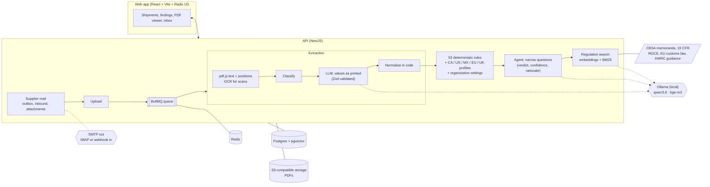

# DocCheck

**Catch freight document errors before customs does.** DocCheck reads the commercial invoice, packing list, bill of lading and, for US ocean freight, the ISF 10+2 filing, as well as air waybills, certificates of origin (CUSMA included), arrival notices, ISPM 15 wood packaging certificates and dangerous goods declarations, from PDFs, phone photos or spreadsheets, then cross-checks them against each other and against the requirements of the destination: CBSA (Canada), CBP (US), ANAM (Mexico), the Union Customs Code (EU) or HMRC (UK). A local model copies the values as printed, plain tested code normalizes them, and 53 deterministic rules do the checking, with the tolerances each organization sets. The model comes back only for the narrow cases a rule cannot settle alone. Every finding links to the exact line in the PDF it comes from and to the regulation passage behind it, and the supplier can be asked for corrected documents without leaving the app. The models run locally: no document goes to an outside AI service.

<p align="center">
  
</p>

## Results

Measured on synthetic shipments generated from a fixed seed (there is no public labeled set of freight documents); see [Evaluation set](#evaluation-set-phase-1). The table is written by `npm run metrics` (`scripts/metrics.mjs`) from the reports in [`eval/reports`](eval/reports).

<!-- metrics:start -->
| Stage | Metric | Result |
| --- | --- | --- |
| Extraction (ollama:qwen3.8) | Field accuracy, 600 PDFs | 99.8% |
| Classification | Document type | 100.0% |
| Rules on ground truth | Recall / precision on 274 covered errors (of 293 injected) | 100.0% / 100.0% |
| Rules on extracted PDFs | Recall / precision, end to end | 100.0% / 99.7% |
| Extraction, scanned PDFs (OCR) | Field accuracy, 120 PDFs (93 complete enough for the rules) | 81.5% |
| Rules on scanned PDFs | Recall / precision, end to end | 81.8% / 67.5% |
| Extraction, scanned PDFs, Unlimited-OCR (Apple Silicon) | Field accuracy, 120 PDFs (108 complete enough for the rules) | 94.0% |
| Rules on scanned PDFs, Unlimited-OCR | Recall / precision, end to end | 100.0% / 79.6% |
| Extraction, ISF PDFs | Field accuracy, 100 PDFs | 99.9% |
| X11 on extracted ISF PDFs | Recall / precision, end to end | 100.0% / 100.0% |
| Extraction, unseen formats (v2) | Field accuracy, 180 PDFs (177 complete enough for the rules) | 98.8% |
| Rules on v2 PDFs | Recall / precision, end to end | 100.0% / 100.0% |
| Rules on ground truth, Mexico / EU / UK (v3-destinations) | Recall / precision on 116 covered errors (of 124 injected, 90 shipments) | 100.0% / 100.0% |
| Rules T1-T13 on ground truth (v1-docs) | Recall / precision on 49 injected errors in 40 shipments | 100.0% / 100.0% |
| Extraction, other documents (v1-docs) | Field accuracy, 43 PDFs of 20 shipments, one layout per type (43 complete enough for the rules) · classification | 100.0% · 100.0% |
| Rules on v1-docs PDFs | Recall / precision, end to end | 100.0% / 100.0% |
| Spreadsheets (.xlsx invoice, .csv packing list) | Field accuracy, 40 sheets, read without a model (14 headers mapped by it) | 100.0% |
| Invoice photos (JPEG, deskew + OCR) | Field accuracy, 20 photos (18 complete enough for the rules; 29 false findings on these clean shipments) | 91.2% |
| Combined PDFs | Documents split with the right type and pages, 60 documents in 20 PDFs | 100.0% |
| Supplier learning | Supplier printing net and gross swapped (36 PDFs): weight fields without / with its corrected examples | 21.8% / 52.7% |
| Agent | Same consignee written differently (40 cases): verdict / right action | 87.5% / 100.0% (0 wrong, 5 unsure) |
| Agent | BL description vs invoice goods (40 cases): verdict / right action | 100.0% / 100.0% (0 wrong, 0 unsure) |

Details in [docs/METRICS.md](docs/METRICS.md); design and lessons in [docs/WRITEUP.md](docs/WRITEUP.md).
<!-- metrics:end -->

## Screenshots

| | |
| --- | --- |
|  |  |
| **Findings** with evidence, the fix to make and the CBP or CBSA passage behind it | **PDF viewer** that opens on the cited page with the line highlighted |
|  |  |
| **Dashboard**: shipments that need attention at a glance | **Shipments**, filtered and paged on the server |
|  |  |
| **Extracted data**: values, weights and origins added up | **Goods**: every invoice line, searchable by description, origin or HS code |
|  |  |
| **Ask for corrections**: the email is drafted from the findings, in English, Spanish or French, and sent from the app | **Conversation**: the supplier's reply comes back with its PDF, which goes into the shipment in one click |
|  |  |
| **Inbox**: unread replies, requests awaiting an answer, overdue and failed ones | **Company**: one record however the documents spell it, with everything they say about it |
|  |  |
| **Product**: price per purchase, per seller and per currency | **Containers**: seal, carrier, vessel and route |
|  |  |
| **Rules**: what is checked for each destination | **Evaluation**: the measured numbers, inside the app |
|  |  |
| Dark theme | Dark theme |

<p align="center">
  
  &nbsp;
  
</p>

Also available: [samples page](docs/screenshots/samples.webp), [companies](docs/screenshots/companies.webp), [products](docs/screenshots/products.webp). The interface is in English, Spanish and French, with light, dark or system theme, and is audited with axe-core (WCAG 2.1 AA) at phone and desktop widths. The images are regenerated with `node scripts/screenshots.mjs` against a running app (`--url`, default `http://localhost:3000`).

## What it does

- **Reads the PDFs**, text layer or scans (OCR with bundled English and French models, or optionally Unlimited-OCR on Apple Silicon), and classifies each one as invoice, packing list, bill of lading or ISF filing confirmation.
- **Extracts typed data with a local model** (Ollama, `qwen3.8`): the model fills a Zod schema with values exactly as printed, and tested code converts them to decimals, ISO dates, kilograms and ISO country codes. A required value the model fills in although the invoice leaves it blank is dropped.
- **Reads the other papers of a shipment**: air waybills (master or house), chamber certificates of origin and CUSMA certifications, arrival notices, ISPM 15 heat-treatment or fumigation certificates and dangerous goods declarations, with the same "values as printed, code normalizes" contract; a value the model fills in although the paper leaves it blank (a CUSMA origin criterion, a packing group, a computed chargeable weight) is dropped.
- **Takes what suppliers actually send**: one PDF with the whole folder is split by page into its documents (each keeps the page numbers of the upload for citations); invoices and packing lists as .xlsx or .csv are read without a model (the model only maps a column header the vocabulary does not know, from the header text alone) and findings open the sheet at the cited cell; phone photos (JPEG, PNG, HEIC) are straightened, cropped and read with OCR, with the cited line boxed on the photo.
- **Runs 53 deterministic rules** (listed [below](#rules-implemented)): package counts and weights across documents, invoice arithmetic, currency, quantities and units per SKU, dates, terms of sale vs freight terms and invoice charges, ISO 6346 container check digits, UN/LOCODEs and port coherence, vessel IMO and carrier SCAC, container capacity and VGM, BL type, ISF 10+2 completeness and the 24-hour filing deadline, importer numbers (Canadian BN/RM, US EIN), duplicate invoices, unit prices against the organization's own price history, the three-way match against imported purchase orders, the invoice fields CBSA (CI1), CBP (19 CFR 141.86), Mexico (RGCE regla 3.1.8), the EU (UCC Annex B) and HMRC require, Mexican RFC and EU/UK EORI numbers, the EU's ICS2 pre-loading data and the UK-EU TCA statement on origin, and the T rules on the other documents: air waybill check digit, pieces and weights (the ocean rules run on the AWB for air freight), certificate of origin parties and goods, the nine CUSMA data elements, dangerous goods without a declaration, wood packaging without ISPM 15 evidence, the arrival notice against the BL or AWB, and an informational check that the original BL and the certificate of origin are signed or stamped (a layout check on the rendered page). Money and weights use fixed-point arithmetic, never floats.
- **Lets each organization tune the rules**: turn a rule off, change its severity, edit tolerances (weight %, days, price deviation, PO tolerances, ISF lead time) and add the carrier SCACs it works with, from the Rule settings page. Each validation run records the settings, tolerances, run date and organization history it used, so its findings stay explainable and the run can be replayed.
- **Asks the model narrow questions only where rules cannot decide**: is a differently written consignee the same company, does the BL cargo description match the invoice goods. Each answer comes with verdict, confidence and rationale; it acts only at confidence ≥ 0.7 (`ACT_CONFIDENCE` in [`packages/agent/src/review.ts`](packages/agent/src/review.ts)) and "unsure" never dismisses a finding.
- **Cites its sources**: every finding points to the page and line of the PDF (opened with the line highlighted), and to a passage of the destination's regulations (CBSA memoranda, 19 CFR, the RGCE and Ley Aduanera, EU customs law, HMRC guidance) found by hybrid search (embeddings + BM25). The model never writes the legal basis.
- **Follows each finding to a decision**: open, waiting for the supplier, accepted risk or false positive (the last two need a reason), with history; a misread value is corrected from the evidence, and the next validation marks new findings and resolved ones ([docs/FINDINGS.md](docs/FINDINGS.md), in Spanish).
- **Talks to the supplier from the app**: the correction request is drafted from the findings in English, Spanish or French, sent over SMTP, and the reply comes back by IMAP or webhook into the same conversation, where its PDF is added to the shipment in one click ([docs/MESSAGING.md](docs/MESSAGING.md), in Spanish).
- **Gives the supplier a portal, no account needed**: the request carries a signed, expiring link to a page where the supplier sees what to fix in their language and uploads corrected PDFs, which are filed in the conversation and checked at once; before shipping, a supplier can check draft invoices and packing lists the same way, with the rules that need the B/L left for later ([docs/PORTAL.md](docs/PORTAL.md), in Spanish).
- **Sends unsure values to a review queue**: every extracted value gets a confidence from signals the pipeline already has (is the value printed on the PDF as copied, OCR word scores, values the normalizer could not read, an optional second reading). A review screen shows the PDF beside the values with the cited line outlined, driven from the keyboard (J/K, A accept, E edit, N next document), and corrects through the same audited corrections ([docs/REVIEW.md](docs/REVIEW.md), in Spanish).
- **Learns each supplier's quirks** (admin switch): a value corrected on a supplier's document becomes an example in the local model's prompt for that supplier's next documents. On a synthetic supplier that prints net and gross weights under each other's label, weight fields go from 21.8% to 52.7% correct; on the regular sets nothing drops (v1 99.8% → 99.8%, unseen formats v2 98.8% → 99.4%; [docs/METRICS.md](docs/METRICS.md#supplier-learning)).
- **Meters usage per plan**: documents extracted and validations per organization and month, Free/Pro/Business limits editable by server admins, bought by the organization's owners and admins, a warning before the limit and either a refusal (402) or an overage notice at it, and an optional Stripe integration that only accepts test-mode keys ([docs/BILLING.md](docs/BILLING.md), in Spanish).
- **Installs as an app and scans with the camera**: a PWA whose service worker caches static files only, never documents; on a phone, pages photographed with the camera are found, straightened and put into one PDF before upload ([docs/PWA.md](docs/PWA.md), in Spanish).
- **Measures itself** on a generated set of 200 labeled shipments (100 per destination, 293 injected errors), field by field and rule by rule, end to end on the extracted PDFs ([docs/METRICS.md](docs/METRICS.md)). Model answers are cached in `eval/cache`, so the evaluation reruns without a model.
- **Works for teams**: organizations with roles (owner, admin, analyst, reviewer, viewer, and clients who read only what is shared with them), invitations by email, assignments, comments with @mentions, notifications in the app and by email, two-step approval of accepted risks and false positives, due dates from the ISF deadline or the ETA with overdue filters, an append-only hash-chained audit log with CSV export, records retention per organization (CBSA 6 years, CBP 5), TOTP two-factor sign-in, OpenID Connect single sign-on and a list of signed-in devices ([docs/ORGANIZATIONS.md](docs/ORGANIZATIONS.md)).
- **Works like a product**: accounts, shipments private to their organization, validation history, JSON export and printable report, aggregated extracted data with companies, products and containers, admin settings changed without a restart, and a read-only demo mode that replays cached model answers.

## Architecture



## Tech stack

| Layer | Tools |
| --- | --- |
| Language | TypeScript end to end, npm workspaces monorepo |
| API | NestJS, Zod, BullMQ (Redis), Postgres with pgvector, S3-compatible storage (MinIO / SeaweedFS), nodemailer, ImapFlow and mailparser for supplier mail |
| Documents | pdf.js (text with positions), tesseract.js (OCR), optional Unlimited-OCR server on Apple Silicon, Playwright (renders the synthetic PDFs) |
| Models | Ollama, run locally: `qwen3.8` for extraction and agent decisions, `bge-m3` for embeddings |
| Web | React, Vite, Radix UI, pdf.js viewer with highlights; English, Spanish, French |
| Quality | Unit tests for every rule and normalizer, API end-to-end tests, axe-core accessibility audit in CI, evaluation set with recall and precision per rule |
| Deploy | Docker Compose (app, Postgres, Redis, MinIO; Ollama on the host for the GPU) |

## Run it locally

Needs Node 22+, Docker and [Ollama](https://ollama.com). From a clone of the repository:

```bash
npm install
cp .env.example .env
docker compose up -d                          # Postgres + pgvector, Redis, MinIO
ollama pull qwen3.8 && ollama pull bge-m3
npm run synth                                 # the 200 sample shipments as PDFs (~1 min)
scripts/start-local.sh                        # checks every dependency, builds, serves http://localhost:3000
```

Then create an account, open **Samples**, pick one and press **Validate**.

## Using the app

The landing page is public; create an account to get in. The interface is in English, Spanish and French (a finding says what is wrong and what to do in the interface language; its technical message and the regulation passages stay in English, as the API returns them) with a light, dark or system theme; both are remembered per device. `npm run a11y` audits every page with axe-core (WCAG 2.1 AA) in each language and theme, at phone and desktop widths, and fails on any violation or horizontal overflow. The app has a sidebar with a dashboard, the organization's shipments (each account starts in a personal organization and can create or join others; see [docs/ORGANIZATIONS.md](docs/ORGANIZATIONS.md)), new shipment, samples, the rule catalog by destination, the evaluation numbers and your account (profile, preferences, password, sign out, delete account). A validated shipment can be exported as JSON or printed as a report. Accounts listed in `ADMIN_EMAILS` also get an Administration section: the extraction model (among those installed in Ollama, with their measured accuracy), agent review and OCR settings, changed without a restart; user roles; and the system status. Sign-ups can be closed from Settings, and are limited to 5 per client address and hour. Create a shipment and drop its PDFs, or pick one of the synthetic samples (each lists the errors injected into it). Extraction runs in the background; then **Validate** shows each finding with its evidence, a link that opens the PDF with the cited line highlighted, the regulation passage that backs it and, when the agent was involved, its rationale. When the model misread a value, the extracted-data panel of a document has an **Edit** mode to correct it by hand: the corrected document must still pass its schema, every change is recorded with who made it, the model's values can be restored, and findings that cite a corrected value say so. `DEMO_READONLY=true` runs the same app as a public read-only demo with no model: curated samples from `data/demo` (`npm run demo:build`), model answers replayed from `eval/cache`, and every write refused except loading and validating a sample (see [docs/DESPLIEGUE.md](docs/DESPLIEGUE.md), section 4). For frontend work, `npm run dev:web` serves the app on :5173 with hot reload and proxies the API.

Needs Postgres, Ollama with `qwen3.8` and `bge-m3`, and optionally Redis and S3 storage (see below).

Self-hosted with Docker: `docker compose --profile app up -d --build` runs the app with Postgres, Redis and MinIO; Ollama stays on the host for GPU access. Deployment guide (Spanish): [docs/DESPLIEGUE.md](docs/DESPLIEGUE.md), covering local setup, backups, Docker, a GPU server behind an authenticating proxy, and a planned static read-only demo.

## Development

Requires Node 22+.

```bash
npm install
npm run build
npm test          # schema and rule tests
npm run smoke     # starts the API, validates a shipment with one injected error
npm run test:e2e -w @doccheck/api   # API end to end against the doccheck_test database (reset on every run)
npm run synth     # regenerates data/eval/v1 (200 shipments + PDFs, ~1 min)
npm run eval:extraction -- --limit 10   # extracts 10 shipments with the local model and writes eval/reports
npm run dev       # API with hot reload on http://localhost:3000
```

The API needs Postgres. Copy `.env.example` to `.env` and point `DATABASE_URL` at a local server (create the database first) or start the bundled one; migrations in `apps/api/migrations` run when the API starts, or with `npm run db:migrate -w @doccheck/api`.

```bash
cp .env.example .env
docker compose up -d   # Postgres + pgvector, Redis, MinIO (optional if you run them yourself)
```

Without Docker: any local Postgres and Redis work, and `scripts/dev-s3.sh` starts SeaweedFS as S3-compatible storage on port 9100 (`brew install seaweedfs`). Without `S3_ENDPOINT` PDFs go to `.data/uploads`; without `REDIS_URL` extraction runs in-process with no retries.

## Repository layout

| Path | What it is |
| --- | --- |
| `packages/schemas` | Zod schemas and TypeScript types for every document and entity, plus a clean sample shipment |
| `packages/rules` | Pure validation rules (no NestJS, no I/O), country profiles (CA, US) and the rule engine |
| `packages/extraction` | PDF text with positions (pdf.js), document classification, LLM extraction with Zod-validated output (Ollama), deterministic normalization, field-level scoring |
| `packages/regulations` | Regulation corpus: chunking, local embeddings (bge-m3 via Ollama), hybrid search (vectors + BM25) with citations |
| `packages/agent` | Citations on findings and model decisions on ambiguous cases (same consignee written differently, BL description vs invoice goods) |
| `packages/synth` | Synthetic shipment generator: ground-truth JSON, labeled error injection, HTML templates rendered to PDF |
| `apps/api` | NestJS API; also serves the web app |
| `apps/web` | Web app (Vite + React + Radix UI): shipments, PDF upload, findings with citations, PDF viewer with highlights. `src/features/<page>` holds one component per file, `src/components/ui` the Radix-based primitives, `src/lib` one helper per file |
| `data/reference` | UN/LOCODE, ISO 3166, ISO 4217 tables (phase 2) |
| `data/corpus` | CBSA memoranda (invoices D1-4-1, marking D11-3-1, proof of origin D11-4-2, valuation D13-4-3 and D13-4-7), 19 CFR (141.83, 141.86, 141.89, Parts 134 and 149, Part 152 subpart E), the RGCE 2026 (reglas 1.9.19 and 3.1.8), the Union Customs Code and Annex B of Delegated Regulation 2015/2446, HMRC's CDS completion guide, EORI manual and TCA origin guidance, as Markdown with URL and effective date, plus the embedding index |
| `data/eval/v1` | Evaluation set: `truth.json` + `labels.json` per shipment (committed), PDFs (generated, git-ignored) |
| `scripts/smoke.mjs` | End-to-end smoke test against the built API |

## Rules implemented

| ID | Rule | Applies to | Severity |
| --- | --- | --- | --- |
| X1 | Consignee matches between invoice and BL (after normalizing case, punctuation, abbreviations, legal form) | All | Medium |
| X2 | Package count matches across invoice, packing list and BL | All | High |
| X3 | Gross weight matches between packing list and BL (0.5% tolerance, configurable) | All | Medium |
| X4 | Net weight is not greater than gross weight | All | Medium |
| X5 | Quantity × unit price = line total; lines sum to the invoice total | All | High |
| X6 | Every amount on the invoice uses the declared currency | All | Medium |
| X7 | Invoice quantities match the packing list, per SKU | All | High |
| X8 | Packing list refers to the invoice number | All | Low |
| X9 | Invoice shipment date within 7 days of the BL shipped-on-board date | All | Low |
| X10 | Container numbers have a valid ISO 6346 check digit | All | Medium |
| X11 | ISF agrees with the invoice: seller, buyer, country of origin, HTS heading | US | High |
| X12 | Terms of sale agree with the BL freight terms (CIF/CFR: prepaid, FOB/FCA/EXW: collect) | All | Low |
| C1 | Invoice has the fields CBSA requires (CI1 fields 1–17: vendor, consignee, origin, terms of sale, currency, packages, description, quantity, price, total, weights) | CA | per field |
| C2 | Invoice is in English or French | CA | Medium |
| U1 | Invoice has the information 19 CFR 141.86(a) requires (port of entry, time of sale, parties, description, quantity, price, currency, origin) | US | per field |
| X13 | UN/LOCODEs on invoice, BL and ISF are in the UNECE code list, in the country the document gives | All | Medium |
| X14 | Ports agree: invoice place of shipment = BL port of loading, US port of entry = BL discharge or delivery, ISF ports = BL ports | All | Medium |
| X15 | Vessel IMO number passes its check digit, a vessel has a voyage, carrier SCAC is valid and known (bundled ocean lines + the account's own) | All | Low (IMO, SCAC format: Medium) |
| X16 | Dates are possible: invoice and on-board date not after the run date, on-board not after ETA, ISF not filed after arrival | All | Medium |
| X17 | Invoice number from this seller not already used in another shipment of the account | All | High |
| X18 | Units of measure agree per SKU between invoice and packing list, converting exactly (dozens/pieces, kg/lb, m/ft); units that do not convert are reported | All | Medium (quantity mismatch: High) |
| X19 | Cargo fits the declared containers: volume and payload per container (20GP, 40GP, 40HC, 45HC, reefers), packing list volume against total capacity | All | Medium (overweight: High) |
| X20 | Container VGM = BL cargo weight + tare, within 5% (configurable); a VGM below the cargo weight is always reported | All | Medium |
| X21 | BL type agrees with the consignee: to order means an original BL, number of originals stated and a notify party; a sea waybill has no originals | All | Medium |
| X22 | Invoice charges agree with the Incoterm 2020: no ocean freight on EXW/FCA/FAS/FOB, no insurance on CFR/CPT, insurance with itemized freight on CIF/CIP | All | Medium |
| X23 | Unit price not far below the organization's own price history for the product (median / MAD, at least 5 past purchases; 30% and robust z 3.5, configurable); the finding lists the series | All | Medium |
| X24 | Three-way match against the imported purchase order: PO number on file, every line ordered, quantity (5%) and price (2%) within tolerance, packed not above ordered | All | Medium |
| C3 | Importer Business Number is a 15-character BN with an RM (import/export) account and a valid check digit | CA | Medium |
| U2 | ISF has the 10 importer elements of 19 CFR 149.3(a) with usable values, is filed against this BL and SCAC, and the carrier's +2 are not reported missing | US | High |
| U3 | ISF filed at least 24 hours before loading (19 CFR 149.2(b); USD 5,000 liquidated damages per violation) | US | High |
| U4 | ISF importer of record and consignee numbers are an EIN (with suffix), CBP-assigned number or SSN, with an EIN prefix the IRS assigns | US | Medium |
| M1 | Invoice has the data RGCE 2026 regla 3.1.8 requires (place and date, consignee, detailed description, quantity, unit and total value, seller, document number, commercial value and currency) and the tax numbers regla 1.9.19 asks for in the pedimento's value data (seller's tax ID, consignee's RFC) | MX | per field |
| M2 | Importer's RFC is well formed: 3 or 4 letters, a real YYMMDD date, homoclave, SAT check digit (the generic XAXX/XEXX RFCs accepted) | MX | High |
| M3 | Invoice is in Spanish, English or French; any other language needs a Spanish translation | MX | Medium |
| E1 | Invoice has the data the EU customs declaration takes from it (Annex B to Delegated Regulation 2015/2446: seller, buyer, importer EORI, delivery terms with place, description, item amount, origin, currency, total) | EU | per field |
| E2 | Importer's EORI number is valid in the EU: member-state prefix (or XI) and at most 15 characters | EU | High |
| E3 | Invoice and BL carry the ICS2 entry summary data for ocean freight: six-digit HS code per line, seller, buyer and consignee (the notify party on a to-order bill) with their countries | EU | High |
| K1 | Invoice has the details an HMRC (CDS) import declaration is completed from, by data element: seller 3/24, buyer 3/26, importer EORI 3/16, delivery terms 4/1, description 6/8, commodity code 6/14, item price 4/14, currency 4/10, origin 5/15 | GB | per field |
| K2 | Importer's EORI number has the UK format: GB (or XI) and 12 digits | GB | High |
| K3 | Goods of EU origin carry a TCA statement on origin that declares preferential origin and, above EUR 6 000, quotes the exporter's REX number | GB | Low when absent, Medium when wrong |
| T1 | Air waybill number has a valid IATA check digit (serial mod 7); a house waybill's master number too | All | Medium |
| T2 | Air waybill pieces match the invoice and packing list (X2 for air) | All | High |
| T3 | Air waybill gross weight matches the packing list and invoice; chargeable weight not below gross | All | Medium |
| T4 | Consignee matches between invoice and air waybill (X1 on the AWB) | All | Medium |
| T5 | Invoice shipment date within 7 days of the flight (X9 on the AWB) | All | Low |
| T6 | Terms of sale agree with the AWB freight terms (X12 on the AWB) | All | Low |
| T7 | Certificate of origin (chamber or CUSMA) exporter, consignee or importer, and producer, are the invoice's parties | All | Medium |
| T8 | Certificate of origin covers every invoice HS subheading and gives the same origin | All | Medium / High |
| T9 | CUSMA certification has the nine minimum data elements (Annex 5-A), blanket period at most 12 months | All | per element |
| T10 | Goods described as dangerous (UN number, "lithium-ion", HS heading) travel with a dangerous goods declaration that lists every UN number | All | High |
| T11 | Wood packaging the documents declare ("WOODEN PALLETS") comes with ISPM 15 evidence; a no-wood declaration does not contradict them | All | Medium |
| T12 | Arrival notice agrees with the BL or AWB: number, containers, packages, weight, consignee | All | Medium |
| T13 | Original BL and certificate of origin show a signature or stamp (informational) | All | Info |

T rules only run when the shipment has their documents; otherwise they are listed as not applicable, not as missing input. On an air shipment (an air waybill and no bill of lading) the ocean rules (X1-X3, X9, X10, X12, X11) do not apply and T1-T6 take their place.

Completeness rules report one finding per missing field, citing the CI1 field, the 141.86 paragraph, the fracción of RGCE regla 3.1.8 or 1.9.19, the Annex B data element or the CDS data element. The RFC check digit is SAT's modulo 11 over its character table; EORI numbers are checked for shape only (their national part is not public), and K3 only sees a statement on origin entered on the invoice data: extraction does not read it from PDFs yet, so on extracted documents K3 points out its absence at Low severity. Regulation excerpts are attached by the agent in phase 4.

Rules X13–X24, C3 and U2–U4 read reference data bundled with `packages/rules` (no lookup at run time): the UNECE UN/LOCODE list (`node scripts/fetch-unlocode.mjs` refreshes `packages/rules/src/data/unlocode.json`), the SCACs of the main ocean carriers, container capacities, payloads and tares, and unit conversions. X17, X23 and X24 also compare with what the organization already has: its other invoices, the prices it paid before and the purchase orders it imported (CSV or JSON, on the Rule settings page). Checks against "today" use the run date passed to the engine, never the clock, so a run gives the same result when replayed. Fields these rules read that extraction does not fill yet (vessel IMO, ETA, number of originals, VGM, ISF filing time and identifiers) come from the documents sent as JSON or corrected by hand; until then the checks that need them are skipped, not reported.

**Rule settings.** Per organization (`rule_settings`, migration 041): owners and admins (`org.settings`) change them, every member who reads the organization's data sees them, and analysts, admins and owners import purchase orders (`shipment.write`); changes go to the audit log. Each rule on or off, a severity that replaces the rule's own, and tolerances, each within bounds the rule declares. Only what differs from the defaults is stored; with nothing stored the engine behaves exactly as without settings. Each validation run stores in `validations.rule_config` the settings it applied, every tolerance in effect, the run date and how much of the organization's history it compared with.

Money and weights are decimal strings and use fixed-point arithmetic — never JavaScript floats.

## Evaluation set (phase 1)

`npm run synth` builds 200 shipments from a fixed seed: 100 to Canada, 100 to the US (with ISF), 25 clean per country and 75 with 1–3 injected errors. Every shipment has an invoice, packing list and bill of lading rendered to PDF from one of three templates per document (classic, modern, legacy), with English/French invoices for Quebec buyers and BL weights in pounds for part of the US set.

Each injected error has a label with the document, field path, before/after values and the rules expected to flag it for that destination. 274 of the 293 injected errors are covered by a rule; the rest are fields the destination does not require (for example terms of sale on a US invoice) or an error hidden by another one. A test checks that the engine flags exactly the expected rules on all 200 shipments and nothing on the clean versions; `npm run eval:extraction` measures recall and precision per rule on the extracted documents.

Sets v1 and v2 were labeled for the first 15 rules (X1–X12, C1, C2, U1), so their evaluations run those rules only (`V1_RULE_IDS`). The later rules are measured on set **v1-rules** (`packages/synth/src/rules-set.ts`): each clean v1 shipment completed with what those rules read (vessel IMO, ETA, VGM and tare, number of originals, ISF filing time and identifiers, Business Numbers with a valid check digit) and an account history (six past prices per product, earlier invoices, the purchase order), then 18 error kinds injected one at a time. The test checks that the completed clean shipments raise nothing under all 31 rules and that each injection raises exactly its labeled rules, citing the altered field; the numbers are in [docs/METRICS.md](docs/METRICS.md).

`npm run synth -- --set v2` builds a second, smaller set (60 shipments, 16 clean) to check that extraction holds up on formats the prompt was never tuned on: two new layouts per document (a European letterhead with "48.600,00", "1 140,50 kg" and "14.03.2026", and a numbered-box form), line tables of 6 to 40 rows that run onto a second page, and parties with accented, non-English names (French, German, Spanish, Vietnamese, Portuguese, Turkish). The v1 layouts stay in the mix as a control group. Set v1 does not change: a test checks every `truth.json` against the published files.

`npm run synth -- --set v3-destinations --no-pdf` builds 90 shipments to the newer destinations (30 each to Mexico, the EU and the UK, 8 clean per destination) in `data/eval/v3-destinations`. Importers carry RFCs with a correct check digit or EORI numbers of the right country; EU imports come only from sellers outside the EU; UK invoices for EU goods carry the TCA statement on origin; about half the Mexican invoices are in Spanish. On top of the shared errors it injects wrong and missing importer numbers, HS codes cut to four digits (ICS2), a missing statement on origin and an invoice language Mexico does not accept. Sets v1 and v2 are unchanged: each destination draws from its own random stream. Only the ground truth is scored so far; the metrics are in [docs/METRICS.md](docs/METRICS.md).

`npm run synth -- --docs` builds set v1-docs: 40 v1 shipments (their clean versions) with the other documents: air waybills in place of the bill of lading for about 40% of them, chamber certificates of origin, CUSMA certifications (for goods made in Mexico), arrival notices, heat-treatment certificates where the goods ride on wooden pallets or crates, and dangerous goods declarations where a line contains lithium batteries. Certificates carry a drawn signature and a coloured stamp. 49 errors are injected (AWB check digit, pieces and weight, certificate exporter and HS code, a missing CUSMA element, a missing dangerous goods declaration or ISPM 15 certificate, an arrival notice that disagrees, an unsigned certificate), each labelled with its T rule. `npm run synth -- --inputs` builds set v1-inputs: 20 clean shipments with the invoice as an .xlsx (half with headers the vocabulary does not know) and the packing list as a .csv, the invoice as a phone photo, and invoice, packing list and BL in one PDF. `node packages/extraction/dist/inputs-eval-cli.js` scores those formats. Neither set changes v1.

PDF rendering uses Playwright's Chromium, or the local Chrome when that build is not installed (`npx playwright install chromium`).

## Extraction (phase 2)

Extraction runs on a local model through [Ollama](https://ollama.com); nothing leaves the machine. Start Ollama, pull a model and point `LLM_MODEL` at it (default `qwen3.8`).

1. `pdf-text.ts` reads the PDF text layer with pdf.js and keeps each line's page and bounding box. Cells are padded to their column so tables stay aligned for the model. Pages without a text layer (scans) are rendered and read with OCR (tesseract.js with bundled English and French models, no system install), and come back in the same shape, so citations and highlighting work on scans too.
2. `classify.ts` detects invoice, packing list, bill of lading, ISF filing confirmation, air waybill, certificate of origin, CUSMA certification, arrival notice, wood packaging certificate or dangerous goods declaration from the title and vocabulary. `split.ts` classifies each page of an upload on its own and starts a new document where a page is titled as another type or its own page marker restarts at 1; `spreadsheet.ts` and `spreadsheet-extract.ts` read .xlsx and .csv without a model; `image.ts` turns photos into image-only PDFs; `attestation.ts` looks for a signature and a stamp on the rendered page.
3. The model fills a "raw" Zod schema with values **as printed** (`"1,140.00"`, `"14-MAR-2026"`, `"2,513 LB"`). Its output is validated against the schema, with one retry on mismatch.
4. `normalize.ts` turns printed values into canonical types in plain, tested code: decimals, ISO dates, pounds to kilograms, country names to ISO codes, units.
5. Findings cite page and bbox: `findSource` locates each evidence value in the PDF lines.

`npm run eval:extraction` scores extraction field by field against `truth.json`, by document type, template and field, and reruns the rules on the extracted documents to measure detection against the injected errors. Model responses are cached in `eval/cache/<model>/`, so a rerun with the same prompt is instant and `LLM_CACHE_MODE=replay` runs the evaluation without a model.

## Agent and regulation search (phase 4)

After the rules run, `/validate` does a second pass:

1. **Citations.** Each finding gets the passage of the destination's regulations that backs it, found by hybrid search over the corpus (embeddings from `bge-m3` plus BM25, merged by reciprocal rank fusion). A passage is attached only when the keyword search also ranks it in the top 5, and rules the corpus does not cover (ISO 6346 container numbers) get none.
2. **Agent decisions** with the local model, each returned with verdict, confidence and rationale:
   - X1 found different consignee names: are they the same company written differently? A confident "yes" dismisses the finding; otherwise it stays with the rationale.
   - A1 (agent rule): is the BL cargo description consistent with the invoice goods? A confident "no" adds a finding with `decidedBy: AGENT`.

`npm run eval:agent` measures both decisions on cases with a known answer built from the synthetic set. `npm run corpus:fetch` refreshes the regulations and `npm run corpus:index` re-embeds them. Model calls are logged to the `llm_calls` table.

## API

| Method | Route | Description |
| --- | --- | --- |
| GET | `/health` | Service status (public) |
| POST | `/auth/register`, `/auth/login`, `/auth/logout` | Accounts: `{ email, password, name }` / `{ email, password }`; the session is an httpOnly cookie. Every other route needs it |
| GET / PATCH | `/auth/me` | The signed-in user; PATCH `{ name }` |
| POST | `/auth/password` | `{ currentPassword, newPassword }`; signs out the other sessions |
| DELETE | `/auth/me` | `{ password }`: deletes the account with its shipments and PDFs (409 while a document is extracting) |
| GET / PUT | `/admin/settings` | Admin: model and OCR settings with where each value comes from; PUT `{ llmModel?, agentEnabled?, ocrLanguages?, ocrScale?, ocrPsm? }` validates all, saves and applies without a restart |
| DELETE | `/admin/settings/:key` | Admin: back to the `.env` value |
| GET | `/admin/models`, `/admin/system` | Admin: installed Ollama models with their measured accuracy; what the server runs with |
| GET / PATCH | `/admin/users`, `/admin/users/:id` | Admin: accounts and `{ role }` (nobody changes their own; the last admin stays) |
| GET | `/rules?destination=CA` | Active rules for a destination |
| GET / PUT / DELETE | `/rules/settings` | The organization's rule settings (PUT and DELETE need `org.settings`) with the rule catalog, defaults and bundled SCACs; PUT `{ rules?: { X2: { enabled?, severity? } }, params?: { grossWeightTolerance?, …, knownScacs? } }` validates (unknown rules and out-of-bounds tolerances are refused) and stores only what differs from the defaults; DELETE goes back to the defaults |
| GET / POST / DELETE | `/purchase-orders`, `/purchase-orders/:id` | The organization's purchase orders for X24 (POST and DELETE need `shipment.write`). POST a CSV or JSON file (multipart field `file`) or JSON `[{ poNumber, currency?, lines: [{ sku?, description?, quantity, unit?, unitPrice? }] }]`; the same PO number replaces the earlier order |
| POST | `/shipments` | Create a shipment: `{ reference?, destination: "CA" \| "US" \| "MX" \| "EU" \| "GB", transportMode? }` |
| GET | `/shipments` | The user's shipments, a page at a time: `?status=all\|open\|attention\|done&destination=CA\|US\|MX\|EU\|GB&q=text&limit=25&offset=0` → `{ items, total, limit, offset, summary }` (`summary` counts every shipment per status group) |
| GET | `/shipments/:id` | Shipment and status |
| PATCH | `/shipments/:id` | `{ reference?, destination?, transportMode? }`. The destination is refused while documents extract and, leaving the US, while the ISF was entered by hand (409); one read from a PDF is set aside and comes back with the US |
| DELETE | `/shipments/:id` | Delete the shipment with its documents, PDFs, extractions, ISF and findings (409 while extracting) |
| GET | `/insights/summary` | The extracted data of all the user's shipments added up: invoiced value per currency, gross and net kg, packages, containers, quantities per unit, and lines and value per country of origin and per HS subheading (`?destination=`) |
| GET | `/insights/lines` | Every commercial invoice line with its shipment: `?q=text&origin=CN&hs=9503&destination=CA&limit=50&offset=0` |
| GET | `/insights/shipments` | Per shipment: invoice, parties, incoterm, value, packages, weights, B/L, vessel, ports and containers (`?q=` also finds a container or B/L number) |
| GET | `/results` | Summary of the evaluation reports in `eval/reports`, for the web app's results page |
| PUT / GET / DELETE | `/shipments/:id/isf` | The shipment's ISF (10+2) as JSON, used by X11 on US shipments. GET says where it came from (`source`: `upload`, `sample` or `pdf` with `documentId`) |
| POST | `/shipments/:id/documents` | Upload documents (multipart field `files`): PDFs (any of the document types; an ISF filing confirmation is stored as the shipment's ISF), photos (JPEG, PNG, HEIC: stored as an image-only PDF after deskew and crop) or spreadsheets (.xlsx, .csv). A file that holds several documents becomes one document per part (`pages`, `sourceDocumentId`) once it is read. Returns 202 with the documents `QUEUED`; `?wait=true` waits for extraction |
| GET | `/shipments/:id/documents/:documentId/sheets` | A spreadsheet document's cells `{ sheets: [{ name, rows }], pages }`, for the viewer |
| POST | `/shipments/:id/documents/:documentId/reextract` | Extract again as a given type `{ type }` (including `ISF`) when classification got it wrong. Values corrected by hand and their history are dropped |
| GET | `/shipments/:id/documents/:documentId` | Document status (`QUEUED`, `EXTRACTING`, `EXTRACTED`, `FAILED`) and, once extracted, values as printed, normalized document (with corrections), issues and `corrected` (paths corrected by hand, with the model's value) |
| PATCH | `/shipments/:id/documents/:documentId/data` | Correct extracted values by hand: `{ changes: [{ path: "/lines/0/quantity/value", value: "120" }] }` (JSON pointers; `null` removes an optional field). The whole document must still pass its schema (400 with `issues`, nothing saved); 409 while extracting. Each change is recorded, an ISF read from this PDF follows, and the shipment goes back to `RECEIVED` until validated again. Findings mark evidence on a corrected value with `corrected: true` |
| GET | `/shipments/:id/documents/:documentId/corrections` | History of the corrections, oldest first: path, old and new value, `edit` or `revert`, who and when |
| POST | `/shipments/:id/documents/:documentId/data/revert` | Put back the values the model read (recorded in the history as `revert`) |
| POST | `/shipments/:id/validate` | Run the rules on the extracted documents (409 while any is still extracting), or on normalized JSON documents in the body `{ invoice?, packingList?, billOfLading?, isf?, airWaybill?, certificateOfOrigin?, cusmaCertification?, arrivalNotice?, woodPackaging?, dangerousGoods? }`; the response lists `notApplicable` rules too; then citations and agent review (`?agent=false` skips the model) |
| GET | `/shipments/:id/validation` | The last validation run with its findings and the destination it ran against |
| GET | `/shipments/:id/validations` | Every validation run, newest first, with findings counted by severity; `/validations/:validationId` is one run with its findings |
| GET | `/shipments/:id/findings` | Findings from the last validation |

Documents passed as JSON in the body of `/validate` take precedence over extracted ones, which keeps the phase 0 flow working for tests.

Finding decisions (`POST /shipments/:id/findings/review`) are described in [docs/FINDINGS.md](docs/FINDINGS.md), the supplier mail routes (`/mail/...`) in [docs/MESSAGING.md](docs/MESSAGING.md), and the supplier portal (`/portal/...`, `/supplier-portal/...`) in [docs/PORTAL.md](docs/PORTAL.md).

## Roadmap

| Phase | Weeks | Deliverable |
| --- | --- | --- |
| 0 · Foundation | 1 | Monorepo, schemas, CI — done |
| 1 · Synthetic data | 2–3 | 200 labeled shipments (100 per country) — done |
| 2 · Parsing + extraction | 4–5 | Typed extraction from PDFs, field-level accuracy measured, Postgres, object storage, queue — done |
| 3 · Rule engine | 6–7 | Shared rules + CA and US completeness profiles, recall and precision measured — done |
| 4 · Agent + RAG | 8–10 | Agent for ambiguous rules, regulation search with citations, local call tracing — done (evaluation running) |
| 5 · Portfolio | 11–12 | Deployed demo, metrics table, write-up — metrics, write-up and results page done; demo pending |

## Disclaimer

DocCheck is a portfolio and learning project. It is not customs advice and does not file anything with any customs authority.

## License

[MIT](LICENSE) © 2026 Snheidert Smalbach
