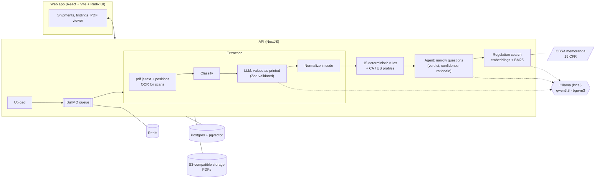

<!--
Proposed top section for README.md (draft, not yet merged).
Image paths are relative to the repository root, where README.md lives, so they do not resolve when
this file is viewed from docs/. Regenerate the images with `node scripts/screenshots.mjs` against a
running app.
-->

# DocCheck

**Catch freight document errors before customs does.** DocCheck reads the commercial invoice, packing list, bill of lading and, for US ocean freight, the ISF 10+2 filing, then cross-checks them against each other and against CBSA (Canada) and CBP (US) requirements. A local model copies the values as printed, plain tested code normalizes them, and fifteen deterministic rules do the checking. The model comes back only for the narrow cases a rule cannot settle alone. Every finding links to the exact line in the PDF it comes from and to the regulation passage behind it. Nothing leaves the machine.

<p align="center">
  
</p>

<!-- METRICS: filled from docs/METRICS.md once the v2 evaluation is final -->

## Screenshots

| | |
| --- | --- |
|  |  |
| **Findings** with evidence, the fix to make and the CBP or CBSA passage behind it | **PDF viewer** that opens on the cited page with the line highlighted |
|  |  |
| **Dashboard**: shipments that need attention at a glance | **Shipments**, filtered and paged on the server |
|  |  |
| **Extracted data**: values, weights and origins added up | **Goods**: every invoice line, searchable by description, origin or HS code |
|  |  |
| **Ask for corrections**: the email is drafted from the findings, in English, Spanish or French, and sent from the app | **Conversation**: the supplier's reply comes back with its PDF, which goes into the shipment in one click |
|  |  |
| **Inbox**: unread replies, requests awaiting an answer, overdue and failed ones | **Company**: one record however the documents spell it, with everything they say about it |
|  |  |
| **Product**: price per purchase, per seller and per currency | **Containers**: seal, carrier, vessel and route |
|  |  |
| **Rules**: what is checked for each destination | **Evaluation**: the measured numbers, inside the app |
|  |  |
| Dark theme | Dark theme |

<p align="center">
  
  &nbsp;
  
</p>

Also available: [samples page](docs/screenshots/samples.webp), [companies](docs/screenshots/companies.webp), [products](docs/screenshots/products.webp). The interface is in English, Spanish and French, with light, dark or system theme, and is audited with axe-core (WCAG 2.1 AA) at phone and desktop widths.

## What it does

- **Reads the PDFs**, text layer or scans (OCR with bundled English and French models), and classifies each one as invoice, packing list, bill of lading or ISF filing confirmation.
- **Extracts typed data with a local model** (Ollama, `qwen3.8`): the model fills a Zod schema with values exactly as printed, and tested code converts them to decimals, ISO dates, kilograms and ISO country codes.
- **Runs 15 deterministic rules**: package counts and weights across documents, invoice arithmetic, currency, quantities per SKU, dates, terms of sale vs freight terms, ISO 6346 container check digits, ISF consistency, and the invoice fields CBSA (CI1) and CBP (19 CFR 141.86) require. Money and weights use fixed-point arithmetic, never floats.
- **Asks the model narrow questions only where rules cannot decide**: is a differently written consignee the same company, does the BL cargo description match the invoice goods. Each answer comes with verdict, confidence and rationale; it acts only at confidence ≥ 0.7 and "unsure" never dismisses a finding.
- **Cites its sources**: every finding points to the page and line of the PDF (opened with the line highlighted), and to a CBSA memorandum or 19 CFR passage found by hybrid search (embeddings + BM25). The model never writes the legal basis.
- **Measures itself** on a generated set of 200 labeled shipments (100 per destination, 293 injected errors), field by field and rule by rule, end to end on the extracted PDFs. Model answers are cached, so the evaluation reruns in seconds.
- **Works like a product**: accounts, private shipments, validation history, JSON export and printable report, aggregated extracted data, admin settings changed without a restart, and a read-only demo mode that replays cached model answers.

## Architecture



## Tech stack

| Layer | Tools |
| --- | --- |
| Language | TypeScript end to end, npm workspaces monorepo |
| API | NestJS, Zod, BullMQ (Redis), Postgres with pgvector, S3-compatible storage (MinIO / SeaweedFS) |
| Documents | pdf.js (text with positions), tesseract.js (OCR), Playwright (renders the synthetic PDFs) |
| Models | Ollama, run locally: `qwen3.8` for extraction and agent decisions, `bge-m3` for embeddings |
| Web | React, Vite, Radix UI, pdf.js viewer with highlights; English, Spanish, French |
| Quality | Unit tests for every rule and normalizer, API end-to-end tests, axe-core accessibility audit in CI, evaluation set with recall and precision per rule |
| Deploy | Docker Compose (app, Postgres, Redis, MinIO; Ollama on the host for the GPU) |

## Run it locally

Needs Node 22+, Docker and [Ollama](https://ollama.com). From a clone of the repository:

```bash
npm install
cp .env.example .env
docker compose up -d                          # Postgres + pgvector, Redis, MinIO
ollama pull qwen3.8 && ollama pull bge-m3
npm run synth                                 # the 200 sample shipments as PDFs (~1 min)
scripts/start-local.sh                        # checks every dependency, builds, serves http://localhost:3000
```

Then create an account, open **Samples**, pick one and press **Validate**.
